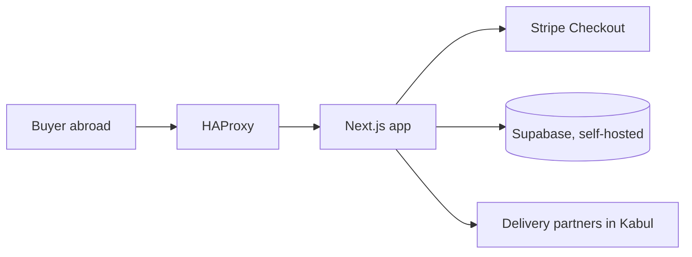

# Tohfa

Tohfa lets people abroad send gift boxes, cakes and flowers to family in Kabul and pay by card. I started it and built all of it.

**Live:** [tohfa.af](https://tohfa.af)

The source code is private. This repository describes what the project is and how it's built.

## What it does

- A shop with 20+ products, delivered through 3 local partners in Kabul
- Card payments through Stripe Checkout
- A stablecoin payment option I designed for countries where card processing is restricted

## Stack

| Area | Tools |
|---|---|
| App | Next.js (App Router) |
| Data and auth | Supabase, self-hosted |
| Payments | Stripe Checkout |
| Hosting | Bare-metal Linux servers, Docker, HAProxy, PM2 |

## How it fits together

Everything runs on Linux servers I set up and look after myself.

## The hard part

Most of the work went into payments across borders. Card payments into Afghanistan are limited, so the checkout takes cards from buyers abroad and the stablecoin option covers places where cards don't work.

## Contact

Questions about the project: [hireamin@auwardak.com](mailto:hireamin@auwardak.com) · [auwardak.com](https://auwardak.com)
